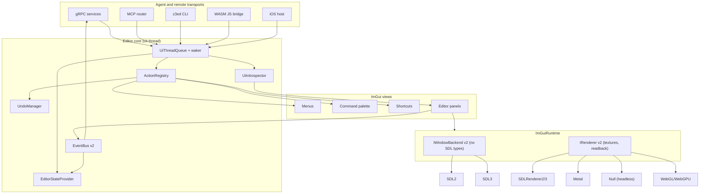

# Dear ImGui 1.93 upgrade and GUI pattern roadmap

**Status:** In review (branch `claude/imgui-193-20261026`, not merged)
**Owner (Agent ID):** claude
**Created:** 2026-10-26
**Last Reviewed:** 2026-10-26
**Next Review:** 2026-11-09
**Universe task:** `task_20261026T191635Z_25425` (`codex-imgui-integration`)

## Summary

1. `ext/imgui` moves from `v1.92.7-docking` (`329c5a6b3`) to
   `v1.93.0-docking` (`b916186e6`). `ext/imgui_test_engine` moves from
   `1918dc90b` to `v1.93.0` (`16b6efbb3`). ImPlot comes from the test-engine
   `thirdparty/` folder and moves with it.
2. The branch addresses the reviewed 1.93 migration issues: ambiguous draw calls,
   inverted drag rectangles, new color slots, the ImPlot item-style API, the
   SDL2 renderer fork, and a use-after-free in the gRPC test harness.
3. The branch also lands the small GUI-pattern and agent-safety fixes listed in
   [Implemented improvements](#implemented-improvements). The largest is
   `UiThreadQueue`, which moves remote handlers that mutate editor state onto
   the UI thread.
4. Larger ideas are recorded as proposals (`F-xx` and `R-xx`), not accepted
   roadmap commitments or prerequisites for this upgrade. `X-xx` records
   decisions from the producer's research, subject to new evidence.
5. Research inputs: ImHex, LumixEngine studio, Gearsystem, Hello ImGui,
   imgui_bundle, Tracy, the ImGui 1.92.7..1.93.0 changelog and source, and an
   audit of yaze GUI, platform, and agent code. Raw reports are not checked in;
   this doc keeps the conclusions.

## Upgrade changes

### Breaking API changes and how yaze handles them

| 1.93 change | yaze fix | Where |
|---|---|---|
| `AddRect`, `AddPolyline`, `PathStroke` take thickness before flags | 3 all-integer calls that no longer compile were rewritten; other old-order calls still compile through obsolete overloads | `room_graphics_content.cc`, `palette_reorder_control.cc`, `minecart_canvas_tool.cc` |
| `AddLine` no longer adds +0.5; closed shapes stroke inside | Canvas grid and memory-editor separators use `AddLineH`/`AddLineV`; canvas overlay rounding/thickness slot bug fixed | `canvas_utils.cc`, `imgui_memory_editor.h` |
| `AddRect`/`AddRectFilled` draw nothing when min > max | Drag previews order their corners | `canvas_runtime_draw.cc` `DrawSelectRect`, `pixel_editor_panel.cc`, `layout_designer_window.cc` |
| New color slots `CheckboxSelectedBg`, `DragDropTargetBg`, `UnsavedMarker` | Written by both theme writers; every-slot test added | `style.cc` `ColorsYaze()`, `theme_manager.cc` `ApplyToImGui()`, `theme_style_snapshot_test.cc` |
| `style.CurveTessellationTol` is obsolete and now means `CurveTessellationMaxError` squared; old color names `TabActive`, `TabUnfocused*`, `NavHighlight` survive only as obsolete aliases | Migrated to `CurveTessellationMaxError`, `TabSelected`, `TabDimmed*`, `NavCursor`; `fr.json` keys renamed | many; `assets/i18n/fr.json` |
| ImPlot 1.x styles items only through `ImPlotSpec` | `BuildItemSpecFromTheme()` and `PlotStyleScope::item_spec()`; `PlotStyleConfig::marker_weight` removed | `implot_support.{h,cc}`, music views |
| Test engine stores the dynamic test name pointer | `SetOwnedName()` after each `IM_REGISTER_TEST` in Click, Type, Wait, Assert | `imgui_test_harness_service.cc` |
| SDL2 renderer backend API changes | Fork re-ported onto 1.93 `imgui_impl_sdlrenderer2.cpp`, keeping the vertex-range patch | `imgui_impl_sdlrenderer2_yaze.cpp` |

### Build configuration: `yaze_imconfig.h`

`src/app/gui/core/yaze_imconfig.h` is now `IMGUI_USER_CONFIG`, set PUBLIC on
the `ImGui` target in `cmake/dependencies/imgui.cmake`. It defines
`IMGUI_DEFINE_MATH_OPERATORS` once for every translation unit. The per-target
copies in `grpc_support.cmake` and `test_support.cmake` were removed.

Rules for this file:

1. Keep it layout-neutral. `src/ios/main.mm` is compiled by Xcode without
   `IMGUI_USER_CONFIG`. An option that changes an ImGui struct, such as
   `IMGUI_DISABLE_OBSOLETE_FUNCTIONS` (it hides `ImGuiIO::FontGlobalScale`,
   `imgui.h:2789-2790`), `ImDrawIdx`, or `ImTextureID`, must go in
   `imgui.cmake` as a PUBLIC definition and in `src/ios/project.yml`.
2. `IMGUI_ENABLE_TEST_ENGINE` is not layout-changing in 1.93. It gates enum
   values (`imgui_internal.h:1104`) and hook calls; the `TestEngine` and
   `TestEngineHookItems` members are unconditional. Earlier notes that called
   it layout-changing were wrong.
3. `yaze_app_objcxx` includes ImGui headers without linking ImGui, so
   `app_core.cmake` copies ImGui's `INTERFACE_COMPILE_DEFINITIONS` onto it.

### Input behavior decisions

1. **Scalar commit (LiveEdit).** Since 1.92.9, stock `ImGui::InputScalar`
   commits on Enter or focus loss. yaze keeps that default. The forked
   `ImGui::InputScalarLeft` keeps live edit because the `*Ex` variants
   (`InputScalarResult`, `InputHexResult`) already split `immediate` changes
   from commits. Agents that drive stock scalars through the harness `Type`
   RPC must send Enter or Tab to commit. Unifying `InputScalarLeft` with the
   stock rule is a follow-up, not part of this branch.
2. **Hex mouse wheel.** The old wheel code in `InputScalarLeft` read every
   step through `*(const float*)`, which is wrong for integer types. The typed
   wrappers now call `ApplyHexMouseWheel<T>()`. Behavior change: the wheel
   only adjusts a hex field while it is active or while Ctrl/Cmd is held, it
   steps by exactly 1, and it clamps to the type's range. `InputHex(int*)`
   clamps at 0 instead of wrapping to `FFFFFFFF`.
3. **`InputHex(uint64_t*)`.** It passed 4-byte step constants for an 8-byte
   type and used `%06X`. It now uses `uint64_t` steps and `%06llX`.

### Old-order draw calls left in place

`scripts/imgui_drawlist_migrate.py` finds and rewrites old-order calls:

```bash
scripts/imgui_drawlist_migrate.py --check src test
```

```bash
scripts/imgui_drawlist_migrate.py --check --axis-lines src test
```

The remaining calls compile and render the same as before. They block only
`IMGUI_DISABLE_OBSOLETE_FUNCTIONS` (F-01). They sit in files this branch must
not edit:

| Owner | Old-order `AddRect`/`PathStroke` | Axis-aligned `AddLine` |
|---|---|---|
| Codex dungeon workbench and room matrix | `room_matrix_content.h:213/453/464`, `room_matrix_census.cc:241/254`, `dungeon_canvas_connected_matrix.cc:653/1218` | `dungeon_canvas_connected_matrix.cc:1130`, `dungeon_workbench_content.cc:774`, `dungeon_workbench_layout.cc:57` |
| Codex shell | `welcome_screen.cc:1275`, `editor_selection_dialog.cc:455`, `dashboard_panel.cc:499` | `right_drawer_manager.cc:1044/1348`, `window_browser.cc:224`, `window_sidebar.cc:819` |
| Overworld (needs green-light) | `overworld_canvas_renderer.cc:467` | `overworld_toolbar.cc:57` |
| Main checkout has uncommitted edits | `object_tile_editor_panel.cc:734/826`, `interaction_coordinator.cc:1155` | `object_tile_editor_panel.cc:716/722/806/812` |

Notes:

1. `dungeon_canvas_connected_matrix.cc:1201` calls
   `AddRectFilled(..., 6.0f, ImDrawFlags_RoundCornersLeft)`. That is correct:
   `AddRectFilled` kept its `(rounding, flags)` order.
2. `room_matrix_content.h:213/464` may also draw inverted rectangles. They are
   Codex-owned and were not changed.
3. `canvas_interaction.cc:128` builds an inverted preview but has no callers.
4. Integration review found that released canvas selections retain drag
   direction. The persistent overlay now orders both tile corners before
   adding the final tile; all four drag directions have geometry coverage.
   `resize_handles.cc:232` was not changed by this repair.

### Known breakage not caused by this branch

`YAZE_BUILD_LAB=ON` fails at `origin/master` with 7 errors from the stale
`WorkspaceWindowManager` API in `src/lab`. The layout designer edits in this
branch were syntax-checked only.

## Implemented improvements

| Area | Change | Files | Tests |
|---|---|---|---|
| Table column IDs | `gui::ColumnLabel(text, stable_id)` returns `text###stable_id`, so a translated or renamed header keeps saved column width, order, and sort. Applied to 10 `TableSetupColumn` calls | `layout_helpers.{h,cc}`, `object_coverage_panel.cc`, `message_editor.cc`, `sheet_browser_panel.cc` | `ColumnLabelTest.*` |
| Themed tables | `BeginTableWithTheming` always pushes 5 colors and 1 style var and pops them itself when `BeginTable` returns false. Callers no longer pop on the failure path | `layout_helpers.cc` | `TableHelpersFrameTest.*` |
| RAII scopes | `IdScope`, `DisabledScope`, `ItemFlagScope`, `ReadOnlyScope` next to the existing style guards | `style_guard.h` | `StyleGuardScopesTest.*` |
| Filter hints | Room, entrance, and sprite catalog filters use `ImGuiTextFilter::DrawWithHint` | `dungeon_room_selector.cc`, `sprite_editor_catalog.cc` | none |
| Debug comparisons | Display Settings popup toggles `io.ConfigDebugDrawListDefaultsToStrokeLegacy` (draw like 1.92) and `io.ConfigDebugHighlightIdConflicts` | `style.cc` `DrawDisplaySettingsForPopup` | none |
| Nearest sampling | `gui::ScopedNearestSampling` queues `DrawCallback_SetSamplerNearest` and restores linear sampling on scope exit. SDLRenderer3 resets the scale mode to linear on every render, so a draw callback is the only per-draw fix. The SDLRenderer2 fork supports reset only | `draw_sampling.h`, canvas files | `DrawSamplingTest.*` |
| Diagnostics | `ConfigureImGuiDiagnostics()` turns on `ConfigErrorRecovery` with debug-log and tooltip reporting in every build, and asserts plus `ConfigDebugHighlightIdConflicts` in debug builds. Every window backend calls it. `imgui_impl_null.cpp` is now built. The SDL3 backend no longer sets `ViewportsEnable` | `imgui_diagnostics.{h,cc}`, `window.cc`, SDL2/SDL3/null/iOS backends, `imgui.cmake` | `ImGuiDiagnosticsTest.*` |
| Headless textures | `NullWindowBackend::RenderImGui()` acknowledges texture requests itself: `WantCreate` and `WantUpdates` become `OK`, `WantDestroy` becomes `Destroyed`. `ImGui_ImplNullRender_RenderDrawData()` in 1.93.0 acknowledges `WantCreate` and `WantDestroy` but never `WantUpdates`, so an atlas that rasterized new glyphs stayed in `WantUpdates` and its `Updates` list grew every frame (`imgui_draw.cpp:4076` clears it only in `OK`) | `null_window_backend.cc` | `ImGuiDiagnosticsTest.NullBackendRunsHeadlessFramesWithImplNull` |
| Hard-edged sprite art | Dungeon sprite preview pixel runs use `PrimReserve` + `PrimRect` instead of `AddRectFilled`. Since 1.93, `AddRectFilled` anti-aliases a rect whose corners are not on whole pixels (`imgui_draw.cpp:2581` falls through to `AddConvexPolyFilled`), so at 1.5x zoom the solid color sat 0.5 px inside each edge and adjacent runs showed seams | `dungeon_canvas_overlays.cc` | `DungeonCanvasSpritePreviewCacheTest.*`, `*DungeonCanvasSpritePreviewBoundsTest.*` (15/15) |
| Widget registry | Removed the unused `YAZE_WIDGET_SCOPE`, `YAZE_REGISTER_WIDGET`, `YAZE_REGISTER_CURRENT_WIDGET` macros. The focused window comes from `NavWindow`. `ExportCatalog` builds JSON with nlohmann (correct escaping). `FindWidgets` matches real globs | `widget_id_registry.{h,cc}`, `widget_state_capture.{h,cc}`, `agent_automation_panel.cc` | `WidgetIdRegistryTest.*`, `WidgetStateCaptureTest.*` |
| UI thread queue (F-02) | `UiThreadQueue::RunOnUiThread()` runs a task on the UI thread and returns `absl::Status`/`StatusOr`. It runs inline when called on the bound thread or when no thread is bound. Callers time out after 5000 ms by default; a timed-out task is abandoned, not run late. The queue wakes the event loop only on the empty to non-empty transition, through `IWindowBackend::WakeEventLoop()` (SDL user event `0x59415A45`). The controller binds the queue, drains it before `NewFrame`, and shuts it down on exit | `src/util/ui_thread_queue.{h,cc}`, `controller.cc`, `iwindow.h`, SDL2/SDL3 backends | `UiThreadQueueTest.*`, `MainLoopEventWaitMsTest.*` |
| Marshaled handlers | HTTP `ShowWindow`/`HideWindow` (Hide always returned 500 before), all 15 canvas automation RPCs, and RomService `WriteBytes` run on the UI thread. gRPC status mapping now covers `DEADLINE_EXCEEDED` and `CANCELLED` | `main.cc`, `canvas_automation_service.cc`, `rom_service_impl.cc` | none (needs a running app) |
| Dead code | Deleted the unused `DrawDisplaySettings` (about 500 lines), `gui::BeginTableCanvas`/`EndTableCanvas`/`SetupCanvasTableColumn`/`BeginCanvasTableCell`, `BeginToolset`/`EndToolset`/`ToolsetButton`, `LayoutHelpers::EndTable`, and `BeginPropertyGrid`/`EndPropertyGrid`. `Canvas::BeginTableCanvas` is a different, used function and stays | `style.{h,cc}`, `ui_helpers.{h,cc}`, `layout_helpers.{h,cc}` | build |

Handlers still not on the UI thread (follow-up to F-02):

1. `imgui_test_harness_service` RPCs.
2. RomService mutating RPCs other than `WriteBytes`.
3. Emulator, render, visual, and widget-discovery services.
4. The `OpenRomOrProject` ROM loader path and the other HTTP handlers.
5. Additional service teardown must preserve the queue's cancellation contract:
   cancel pending UI work before waiting for service shutdown, and clear the
   guarded backend waker before destroying its window backend.

Found and not fixed:

1. `DrawDisplaySettingsForPopup` "Open Theme Editor" draws
   `ShowSimpleThemeEditor` only on the click frame (`static bool ... = true`
   inside the button branch), so the editor flashes for one frame. This
   predates the branch. The fix is to open the theme editor window through the
   workspace window manager, which Codex owns.
2. `ThemeManager::ShowThemeSelector` has no callers after the dead-code
   removal. `docs/internal/plans/ui-polish-implementation.md:116` still
   references it.
3. Upstream `imgui_impl_null.cpp:85` never acknowledges `WantUpdates`. The
   current upstream docking tip has the same code. yaze works around it (see
   Headless textures above); the bug can be reported upstream.
4. `dungeon_room_selector.cc` (filter hints) also has uncommitted edits in the
   main checkout on `editor-pattern-cleanup`. Expect a merge conflict there.
5. Integration review fixed the floating paste's adjacent pixel fills using
   `PrimReserve` + `PrimRect`, with actual panel geometry coverage at 1.5x
   zoom. Other pixel-grid fills at `pixel_editor_panel.cc:623`, `:671`, and
   `:745` remain outside that focused repair.
6. `DungeonCollisionJsonCommandsTest.WaterFillImportFailsWhenRequiredD4RoomHasNoCollisionData`
   fails on Windows only (`INTERNAL` instead of `kFailedPrecondition`;
   `[json.exception.parse_error.101] ... attempting to parse an empty input`).
   It passes on macOS and is not in the known Windows-failure list. The
   branch does not touch that command, so it is likely an existing Windows
   file-read problem; not investigated.

## Follow-up PRs

Ordered by impact, then effort. Ownership lists files this repo's agents must
not edit without sign-off.

| ID | Scope | Effort | Ownership |
|---|---|---|---|
| F-07 | One source for agent tool schemas: generate `function_schemas.json`, the z3ed catalogue, and the yaze-mcp tool list from one registry table | M | none |
| F-04 | Screen capture: test-engine `ScreenCaptureFunc`, `IRenderer::ReadPixels`, headless capture through the null renderer | M | none |
| F-10 | Edit transactions keyed by `ImGuiID` (activate = snapshot, deactivate-after-edit = one undo step, Escape = restore); port palette color edits; fix the property inspector commit contract | M | `property_inspector` consumer is Codex `settings_panel` |
| F-09 | DPI and font roles: `style.FontScaleMain`/`FontScaleDpi` instead of `io.FontGlobalScale` (29 uses), load NotoSansJP once, drop `GlyphRanges`/`PixelSnapH` | L | Codex: `window_sidebar.cc` font push, `settings_panel` scale UI |
| F-11 | Hex editor: replace the old `imgui_memory_editor` fork with imgui_club v0.59, undoable and `Rom::set_dirty`-aware writes, Find, bookmarks | L | `overworld_editor.cc` includes the header (keep the API) |
| F-01 | CI job with `IMGUI_DISABLE_OBSOLETE_FUNCTIONS`; migrate the calls above plus `GetTexDataAsRGBA32` (107 test uses), `BeginChild(bool)` (148), one-arg `PushFont` (6), `ImGuiMod_Shortcut` (4); set the define in `imgui.cmake` and `src/ios/project.yml` together | M | see the table above |
| F-05 | Ctrl+S: gate on ROM loaded and dirty, show the save error in a toast (`shortcut_configurator.cc:325-330` drops the status) | S | shell toast is Codex-adjacent |
| F-06 | EventBus: snapshot handlers before dispatch, mutex, RAII `ScopedSubscription`, merge `core/event_bus.h` and `registry/event_bus.h` | S | none |
| F-03 | Unregister and free dynamic harness tests after they finish | S | none |
| F-08 | Window and tab titles as `Label###stable_id` so translation and dirty markers keep dock layout | S | Codex: workspace window manager, sidebar |
| F-13 | One theme table shared by Classic and presets (removes the two-writer trap); ImPlot theming; replace literal colors and duplicate status-color helpers | M | split by area; touches Codex shell |
| F-14 | Per-panel error boundary with `ErrorRecoveryStoreState`/`TryToRecoverWindowState` around lazy panel draws; crash-log popup on next launch | M | Codex: `workspace_window_manager` |
| F-16 | Route panel-scoped shortcuts through `ImGui::Shortcut` with focused/global routes | M | Codex: dungeon shortcuts |
| F-12 | Emulator debugger UX: static memory editor, no-op region combo, disassembly breakpoints and theme colors | M | `graphics_editor.cc` has uncommitted main-checkout edits |
| F-23 | Selector robustness: `ImGuiTestRef` paths, seed-0 label hashing, ID Stack Tool paths in errors | M | none |
| F-25 | Persist panel open state through an `ImGuiSettingsHandler` in the docking ini | M | Codex: layout presets |
| F-17 | ImPlot as its own submodule at v1.1; NFD v1.3.0 to v1.4.1 with SDL3 parent windows | S | none |
| F-27 | Harness: test-engine 1.93 ops (`ItemDragToPos`, `ItemMakeVisible`, `TableResizeColumn`); agents send `ImGuiMod_Ctrl`, not `ImGuiMod_Shortcut` | S | none |
| F-22 | Docs: automation architecture, rewrite `platform_backends.md`, agent API map, ImHex comparison refresh | S | none |
| F-24 | WASM menu actions advertised and handled from one list | S | none |
| F-18 | Metal `RenderCopy` batching (`waitUntilCompleted` per blit); WASM frame skipping under ASYNCIFY | M | none |
| F-19 | Mobile and web lifecycle events; persist main-window bounds | M | none |
| F-20 | Remove direct SDL calls from editor panels; remove `g_window_is_resizing` and legacy `core::Window` | M | check overworld call sites |
| F-15 | Drag-and-drop payload names in `drag_drop.h`; one `AcceptColorDrop` | S | Codex: `activity_bar` |
| F-21 | CI drift check for `imgui_impl_sdlrenderer2_yaze.cpp`, or upstream the vertex-range patch | S | none |
| F-26 | `IMGUI_TEST_ENGINE_ITEM_INFO` on custom `ItemAdd` widgets (needed by R-03) | S | none |

Also follow-ups from this branch:

1. Run the draw-list codemod on the files in the ownership table once their
   owners agree.
2. Unify `InputScalarLeft` commit behavior with stock `InputScalar`.
3. Fix the 7 `src/lab` build errors so the layout designer builds again.

## Target architecture (roadmap)



1. All agent traffic enters through `UiThreadQueue`. No handler touches editor
   state on a socket thread. This branch adds the queue.
2. `ActionRegistry` is the one command model. Menus, the palette, shortcuts,
   gRPC, MCP, and z3ed read it, and tool schemas are generated from it.
3. `UiIntrospector` uses ImGui item hooks so release builds can list and act
   on widgets without linking imgui_test_engine. `WidgetIdRegistry` shrinks to
   annotations keyed by `ImGuiID`.
4. `ImGuiRuntime` owns context creation, config, fonts, and frame pacing. Today
   five init paths duplicate this.

| ID | Item | Effort |
|---|---|---|
| R-01 | `ActionRegistry` replacing `Shortcut`, `CommandEntry`, `CommandInfo`, menu items, and `UIActionRequestEvent` (~52 register sites; Save ROM has 4 paths) | XL |
| R-03 | `UiIntrospector` on item hooks in release builds | L |
| R-02 | Agent RPCs `ListActions`/`DescribeAction`/`InvokeAction`/`Undo`/`Redo`; router-mode MCP generated from R-01; in-app MCP transport only after the queue | L |
| R-04 | `EditorStateProvider` replacing the WASM, iOS, and HTTP state snapshots; `EventBus v2` with a `SubscribeEvents` stream | L |
| R-05 | SDL-free `IWindowBackend`/`IRenderer`, `ImGuiRuntime`, `ToImTextureRef` for 49 raw casts | XL |
| R-06 | Desktop GPU renderer: SDL3 + `imgui_impl_sdlgpu3`, WebGPU later | XL |
| R-07 | `UndoManager` groups, savepoints, history listing | M |
| R-08 | Declarative settings schema; editor lifecycle hooks | M |
| R-09 | ImGui-level input replay for agents | M |
| R-12 | md4c markdown and `yaze://` deep links in agent chat | M |
| R-13 | `BoxSelect2d` multi-select for tile and sheet grids | M |
| R-10 | `TaskManager` with progress and cancel | L |
| R-11 | Replace the 2019 `text_editor.cc` fork with goossens/ImGuiColorTextEdit | L |
| R-14 | Widget library and splitting functions over 300 lines | L |
| R-15 | Canvas automation for dungeons | L |

## Rejected

| ID | Idea | Reason |
|---|---|---|
| X-01 | Enable `ConfigIniSettingsAutoDiscardMonths` | Layout JSON stores ini text without `LastUsed` lines, so saved layouts would be deleted |
| X-02 | Turn on `LiveEditOnInputScalar` globally | One undo entry per keystroke; confuses agent `Type` RPCs |
| X-03 | `IMGUI_DISABLE_OBSOLETE_FUNCTIONS` in the upgrade PR | Layout-changing, needs `project.yml`, 300+ call sites and third-party code; done as F-01 |
| X-04 | Copy ImHex code | ImHex is GPL-2.0-only; borrow patterns only |
| X-05 | ImHex-style dynamic plugin ABI | ABI and cross-DLL ImGui context cost; static registration through R-01 is enough |
| X-06 | Run MCP/gRPC handlers on the socket thread | Races the UI thread |
| X-07 | Another agent socket before registry unification | Adds a fifth tool surface that drifts |
| X-08 | netImgui | Headless capture (F-04) and R-03 cover remote inspection |
| X-09 | imgui-ws, imgui_tex_inspect, imgui-command-palette, imgui-notify, other text editors, imgui_md, ImGuiFileDialog, imgui-mcp | Stale upstreams or duplicates of features yaze has |
| X-10 | Fix the dead `DrawDisplaySettings` | No callers; deleted, and the live popup copy fixed instead |

## Validation

The table records Claude's producer runs from 2026-10-26; they predate the
integration corrections and are not final integrated-head acceptance.
Codex's reviewed donor build of `yaze` and `yaze_test_unit` passed, followed
by 127/127 focused tests across 16 suites with no skips. The run used a
disposable working directory and `YAZE_APP_DATA_DIR`. Older property and
deferred-input fixtures rewrote that directory's sentinel `imgui.ini`;
this run does not establish suite-wide ini isolation. Integration restores
extended hex inputs' popup blocking, rejects inline queue work after
shutdown, and disables ini persistence in the new frame fixtures. Their
separate isolation check, current-master composition, and exact-head
platform/CI results belong in the integration PR.

| Check | Result | Command or log |
|---|---|---|
| Full build, macOS arm64 | exit 0, 0 errors, 0 compiler warnings (only the known duplicate-library `ld` warnings) | `cmake --build --preset mac-ai -j 4` |
| Focused unit tests | 105/105 pass across 13 suites: `UiThreadQueueTest` (10), `MainLoopEventWaitMsTest` (3), `WidgetIdRegistryTest` (4), `WidgetStateCaptureTest` (1), `ColumnLabelTest` (2), `TableHelpersFrameTest` (6), `ImGuiDiagnosticsTest` (5), `ThemeStyleSnapshotTest` (31), `PropertyInspectorTest` (14), `DeferredScalarInputTest` (5), `HexInputTest` (4), `StyleGuardScopesTest` (12), `DrawSamplingTest` (8) | `yaze_test_unit --gtest_filter=...` with an empty `HOME` |
| Queue stress | `UiThreadQueueTest.*` 10/10 repeats pass, no skips | `--gtest_repeat=10` |
| GUI command results reported by producer | Four commands exited successfully. Review reproduced `headless_gui_suite` selecting zero GoogleTests; that command was not GUI acceptance. Its registration now selects the two existing null-backend controller-close tests and rejects an empty selection. The other three native runs remain historical producer evidence. | `ctest -R ...` with a copy of the vanilla ROM; Codex empty-selection control exited 0 with 0 tests |
| Windows full stable suite | Build ok (379 s). 8 failures: 7 sprite preview tests (a branch regression; reproduced on macOS and fixed by the hard-edged sprite art row, 15/15 pass on macOS after the fix) and the Windows-only WaterFill test (found-and-not-fixed item 6). The snapshot predates the sprite and queue test fixes; Windows was not rerun after them | `scripts/remote/mm-test.sh 92b9d7825 --full` (dangling snapshot commit) |
| Adversarial review | 4 finders (concurrency, ImGui API, drawing, build and platform) and 1 verifier. 1 finding kept as PLAUSIBLE, 0 refuted: `TaskStartedBeforeTimeoutIsAwaited` failed if `Drain()` started after the 500 ms caller timeout. Fixed: the test now skips only when the measured delay proves a scheduler stall | `test/unit/util/ui_thread_queue_test.cc` |

The first focused run failed `ImGuiDiagnosticsTest.NullBackendRunsHeadlessFramesWithImplNull`:
the font atlas stayed in `WantUpdates` (status 3). That led to the Headless
textures fix above.

Codex's Windows check of integrated product commit `7f1ae855` passed all
13 stable CTest entries: 5,798 GoogleTest cases passed and 459 were skipped.
The qualified command included `--target z3ed` and used `MM_REMOTE_ROOT=ym`.
The default runner job path reproduced two unchanged artifact-path failures;
the same executable passed those cases with a shorter temporary root, and a
padded-root control reproduced the collision-source failure. No assertions
or production writers were changed to obtain the qualified result. Final
commit CI remains authoritative for the later test-integrity corrections.

Review also corrected the new queue timeout test's skip condition: a task
that actually started can no longer be mistaken for a scheduling stall.

## Gaps

1. The integrated product source was built and tested on medical-mechanica
   as qualified above. Linux, iOS, and WASM were not locally built from this
   branch. CI covers Windows and Linux; iOS builds `main.mm` without
   `IMGUI_USER_CONFIG`, which is safe only while `yaze_imconfig.h` stays
   layout-neutral.
2. Visual parity was not checked with screenshots: stroke placement,
   anti-aliased line texture sampling, and `CheckboxSelectedBg` on all 18
   theme presets.
3. Only drag-preview rectangles were audited for inversion. Rectangles built
   from user-entered coordinates were not.
4. The harness and the gRPC threading changes were not run under TSan.
5. ImPlot, imgui_club, the text editor fork, and NFD were not compiled with
   `IMGUI_DISABLE_OBSOLETE_FUNCTIONS`.
