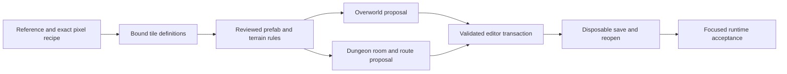

# Zelda object authoring workflow

Build maps from reviewed semantic objects and explicit constraints, while keeping
exact pixels and the engine's own data model. This document defines the intended
workflow across art, tile placement, overworlds and dungeon layouts. It is a
design contract; the end-to-end generator and prefab executor are not implemented.

Use the [pixel recipe tool](../../scripts/pixel_art/README.md),
[terrain catalog](../public/reference/terrain-catalog.md) and
[dungeon coverage contract](dungeon-tileset-coverage.md) as existing foundations.
Keep source observations, suggested meanings, reviewed objects and executable
placement plans distinct.

A model can propose structured pixel recipes, named-object selections and layout
constraints within a drawing profile. Deterministic tools materialize only the
declared operations and reject invalid inputs. No trained style model exists in
this prototype, and passing validation does not certify aesthetic consistency.

## Authoring stages

| Stage | Input and result | Validation before the next stage |
|---|---|---|
| Reference and original pixels | Pinned local references, explicit indices, palettes and drawing recipes produce lossless native-size art. | Palette/index limits, planar roundtrip, exact RGB555 when requested, native-scale visual review. |
| Engine tile binding | Authored characters are bound to actual graphics slots, palette banks/halves, tilemap words and shared consumers. | Actual target context and allocation/impact report; a drawing budget reserves no engine space. |
| Named objects and terrain rules | Existing tile groups become sparse prefabs; cliffs/shores become directional edge rules; trees can have explicit overlap rules. | Exact source anchors, masks, profile compatibility, footprint, collision observations and semantic review. |
| Layout proposal | A deterministic recipe chooses compatible objects within a bounded map/room and connects their ports. | Bounds, occupied/clearance cells, connectivity, transitions, progression constraints and capacity budgets. |
| Editor transaction and engine proof | The proposal uses existing editing/history/save paths in a disposable target. | Before/after render and data diff, undo/redo, save/reopen, then runtime checks for behavior that requires them. |

## Common object contract, separate engine representations

Share provenance, review states, anchors, masks, connectors and constraint
vocabulary. Keep payloads specific to their engine representation:

| Representation | Unit and interpretation |
|---|---|
| Character art | 8x8 indexed pixels plus explicit palette; separate from placement words. |
| Overworld Tile16 | Four Tile8 words containing character, palette, flip and priority data. |
| Overworld Tile32 | Four Tile16 references; map edits can require new or reused Tile32 definitions. |
| Overworld prefab | A rectangular or sparse Tile16 footprint anchored within a parent area. |
| Dungeon object | A serialized object ID, position, size and stored list, interpreted by an engine draw routine. |
| Dungeon room | Header floors/layout, ordered object lists, separate doors, state and global tables. |
| Route graph | Connections and required item/key/state constraints over rooms or areas. |

A dungeon object is not an overworld metatile. A 16x16 art module is not an engine
object. Coordinate fields must state their units and coordinate space; do not
reuse raw integers across Tile8, Tile16, parent-area, screen and room coordinates.
Resolve dungeon size fields through the specific routine, rather than treating
them as universal pixel dimensions.

Each future prefab/recipe record needs these information groups. These are
requirements for an extension, not a currently executable JSON schema:

| Group | Required information |
|---|---|
| Identity and provenance | Stable semantic/content identity, schema version, source ROM or asset identity, definition/profile fingerprints, exact source positions, tool/source version and review state. Ranking IDs such as `ST021` are discovery handles, not stable public IDs. |
| Appearance | Exact tile/word payload or art references, palette/sheet compatibility, transparency, priority, layers, animation and lighting constraints. |
| Geometry | Explicit anchor, native footprint, occupied cells, skip mask, clearance cells, substrate/elevation constraints, connectors and allowed transformations. |
| Behavior | Known collision/interaction data, unresolved behavior, entrances/exits, protected cells and state dependencies. An image label does not establish any of these. |
| Placement | Deterministic inputs/seed, target identity, before-value guards, write order, overlap policy, capacity plan, expected changed cells and validation evidence. |

An absent sparse cell means **skip this destination cell**. It is not transparent
palette index zero, an instruction to clear the destination, a valid tile ID or
an excluded source screen. Give those concepts separate fields. Preview checker
colors and magenta masks must never become tile data.

Keep packed palette words and indexed native pixels as authorities. Generate
display RGB with the same channel expansion as
[Yaze](../../src/app/gfx/types/snes_color_math.h). Preview enlargement uses integer
nearest-neighbor scaling. Large contact-sheet entries need a separate native-size
view; default filtered thumbnails cannot establish exact pixel quality.

## Discovery is not a placement library

Connected components and frequent rectangle mining find useful candidates.
They also find disconnected border fragments, scenery fused into forests and
objects that include unrelated ground or path cells. Keep candidates suggested
until their footprint and role are reviewed.

For every retained occurrence, compare every non-skip cell to the source grid.
Validate input identity globally before grouping or rendering: mixed-ROM parents
and grid/profile/export mismatches must fail, even when no parent is duplicated.
If a repeated pattern is canonicalized by a phase shift, update and retain its
anchor/phase, original extent and repeat counts. Do not keep original occurrence
coordinates beside a differently phased repeat unit. Report filtered or greedy
non-overlapping occurrence counts with that meaning; they are not a complete
list of all overlapping uses.

The existing terrain label sidecar binds one Tile16 label to exact adapter,
definition and render-profile fingerprints. It does not execute multi-cell
prefabs or neighbor rules. Reuse its identity and review-state rules, then design
a distinct versioned assembly/placement contract. Do not assume an old proposal
document is accepted editor configuration.

Source graphics and palette compatibility travel together. Matching Tile16 IDs
or Tile8 words alone does not establish the same appearance in another area.
Retain source-zero transparency masks even if the editor remaps displayed indices.
Static exports do not cover custom runtime DMA, time tinting, overlays or all
animation states.

## Overworld construction

Start with one bounded scene: a path or clearing, two trees/palms, a cliff, a
stair and two boundary connections. Use reviewed existing definitions before
allocating new art. This proves placement machinery independently of a new
graphics import.

1. Resolve the parent-area shape and active graphics/palette profile. Preserve
   excluded screens, reserved overlays, entrances, exits and unrelated cells.
2. Select compatible prefabs and terrain roles. Specify shore/cliff directions,
   elevations, concave/convex corners, caps and transitions. Validate tree overlap
   translations and conflicting writes; a repeated forest is not automatically
   one seamless texture.
3. Produce a dry-run plan with source/destination guards, changed Tile16 cells,
   all touched Tile32 blocks, actual reuse/new-definition demand and capacity.
   Arbitrary Tile16 alignment can change the number of touched Tile32 blocks.
4. Use the existing painting/history transaction for the entire proposal. Render
   joins and walkable/blocked/unknown cells together. Verify boundary connections
   and protected placements before save/reopen in a disposable target.
5. Check actual movement, canopy/trunk behavior, shore/cliff transitions and
   relevant runtime effects when the change depends on those behaviors.

Changing shared collision attributes requires the Tile8-to-Tile16-to-map consumer
graph. Cloning a Tile16 with the same Tile8 references does not isolate a Tile8
collision change. Unknown or high-ID collision stays unresolved until the actual
runtime contract is traced. Visual foreground priority is separate from collision.

Cross-project placement also needs asset compatibility/remapping. Do not treat a
saved selection or scratch canvas as proof of a reusable, portable prefab catalog.

## Dungeon layout generation with objects

Generate topology before decorating a room: entry/exit ports, traversable routes,
keys/items/state requirements and optional branches. Bind those requirements to
approved game design. A generator must not invent story, a follower mechanic,
item progression or save flags while solving an art/layout problem.

Expand a room template into the engine's own structure: floor selectors, layout,
ordered object lists, doors/stairs and any required separate tables. Place named
wall, corner, platform and fixture objects using their actual routine semantics.
Use the [source inventory](../../scripts/pixel_art/INVENTORY.md) and all 24 coverage
families. Keep unclassified primitives, custom overrides and layout-generated
objects visible; an object-list census alone is not complete room coverage.

The complete architectural set includes cardinal wall faces and depths, inside
and outside corners, kinked/deep corners, diagonals, ceilings, height changes,
door/stair joins, pit/water edges and foreground/priority states. Bind palette
banks/halves and all loaded graphics slots independently of semantic BG names.

Use ordered room replay into disposable in-memory BG/layout buffers for actual
character coverage. Retain layer-aware raw writes, order, flags, overwrites,
reveal masks and priority-only changes, plus final effective maps. Include floors,
layout, doors, blocks/torches, chest-hole overlays and animations. Isolated
`trace_only` captures skip contextual writes; flattened x/y layouts lose layers.
Neither is sufficient for a placed-room dependency inventory.

Use existing dungeon stream/capacity preflight and guarded object edit paths.
`dungeon-stream-plan` supplies read-only stream inventory, alias and free-space
diagnostics; it is not an immutable replacement/write plan. The inspected
`dungeon-export-room` command still emits placeholder lists, so do not use its
empty arrays as evidence that a room is empty. Typed room-transfer and mixed
selection capabilities in newer editor lineages are separate source paths.
Check connection symmetry, door states, stair destinations, reachable fixtures,
key availability and return paths before committing a proposal. Render open and
closed/state variants, save/reopen a disposable copy, and run the changed puzzle
behavior separately when needed. A route solver is a design check, not gameplay
acceptance.

## Implementation boundary and first milestone

Existing tools provide exact pixel recipes, source-backed dungeon metadata,
profile-aware Tile16 observations/labels and several editor/CLI editing paths.
The unified semantic prefab catalog, terrain-rule compiler, layout generator,
usage exporter and end-to-end placement transaction need explicit implementation
and tests. Inspect the current checkout and source APIs before selecting the
editing backend; other branches may contain newer lifecycle/selection work.

Start with one usable disposable map through an already qualified project,
document, painting/history and save/reopen path when one exists. Use reviewed
existing tiles, preserve the seed's profile and unrelated authoring fields, and
publish the actual editable artifact with its changed-cell summary. Keep a
sidecar-only pilot separate from ROM compilation and runtime admission. Scope
new catalog or executor work from the concrete gaps this pilot exposes.

The first new semantic-tooling milestone is one deterministic, read-only prefab
proposal with exact source-anchor/profile checks, sparse-mask semantics, Tile32
capacity reporting and a before/after preview. Bind it to the existing undo/save
paths after validation; do not create a second editing transaction model. Use
the same provenance/constraint approach for one architectural dungeon room,
while retaining the dungeon-specific object representation.

Shared base writes, release staging and project-specific approvals are separate
from preparing these artifacts. Keep approval decisions attached to the exact
candidate and destination rather than inferring them from a successful preview.
